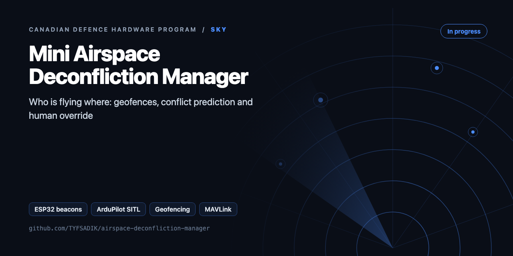
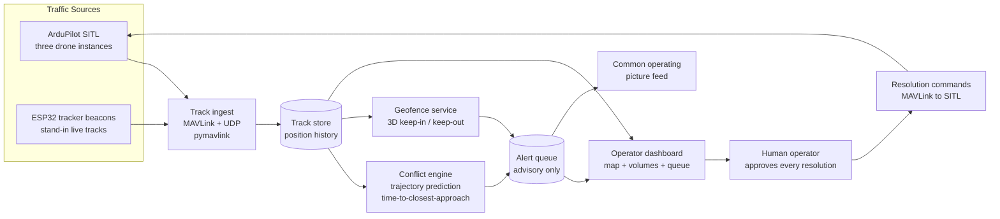

<div align="center">



# Mini Airspace Deconfliction Manager

**Small-scale UAS airspace manager: ESP32 tracker beacons, ArduPilot SITL simulated drones, dynamic geofences, predicted-conflict alerts, human override.**

[](https://github.com/TYFSADIK/airspace-deconfliction-manager/actions/workflows/tests.yml)   [](LICENSE) [](https://github.com/TYFSADIK/defence-hardware-program)

[Build guide](docs/project-page.md) · [How it works](#how-it-works) · [Quick start](#quick-start) · [Program hub](https://github.com/TYFSADIK/defence-hardware-program)

</div>

## Overview

When a dozen uncrewed aircraft share the same block of sky, somebody, or something, has to keep them apart. The **Canadian Army is studying exactly this problem**: how to manage airspace shared by many uncrewed aircraft at once, a discipline known as airspace deconfliction. With the **Defence Drone Initiative** (launched July 23, 2026) promising fleets of cheap tactical drones, and DRDC trials like Operation NANOOK pushing more uncrewed systems into the same training areas, deconfliction stops being an airline problem and becomes a platoon-level one.

This build explores that problem safely and cheaply. It is **mostly simulation**: several ArduPilot SITL drone instances fly missions on my homelab and stream MAVLink telemetry into a manager I wrote. A handful of physical ESP32 tracker beacons stand in for live tracks, so there is real RF hardware in the loop. On top of that track picture sit the two things a deconfliction system actually does: **predict conflicts before separation is lost**, and **enforce dynamic geofences** the operator can draw, move, and resize live.

The design rule that shapes everything: the manager is **advisory, never autonomous**. It proposes resolutions, climb, hold, reroute, and a human approves every single one. That is deliberate: it mirrors how military airspace control actually works, and it makes the system safe to experiment with at any scale.

## How it works



*Simulated and physical tracks flow into one track store; the conflict engine and geofence service raise alerts; a human approves every resolution before any command goes back to an aircraft.*

## Quick start

```bash
python demo.py
python -m unittest -v
```

Real output from the demo, run on simulated data:

```text
{'type': 'conflict', 'a': 'UAS-1', 'b': 'UAS-2', 'severity': 'advisory', 't_cpa': 30.0, 'h_m': 0.0, 'v_m': 2.0, 'degraded_track': False}
{'type': 'geofence', 'track': 'UAS-3', 'fence': 'school', 'in_s': 20}
after operator ack: [{'type': 'geofence', 'track': 'UAS-3', 'fence': 'school', 'in_s': 20}]
```

## What's in this repo

| File | Purpose |
|---|---|
| `airspace/geo.py` | lat/lon to local ENU metres |
| `airspace/tracks.py` | Track store with velocity estimate, dead-reckoning, and live/coasting/lost quality |
| `airspace/conflict.py` | Closest-point-of-approach conflict prediction with horizontal and vertical separation |
| `airspace/geofence.py` | Keep-out and keep-in polygons with altitude bands and look-ahead breach prediction |
| `airspace/manager.py` | Raises alerts only. Humans acknowledge or override, and every action is logged to JSONL |

## What you need

| Category | Item | Notes |
|----|----|----|
| Hardware | 3 ESP32 tracker beacons | Cheap boards as live RF stand-ins; disable modem sleep in the firmware |
| Hardware | Compute | Existing laptop or homelab node for the SITL instances and the manager |
| Software | ArduPilot SITL | Free; several drone instances with unique -I offsets and sysids |
| Software | pymavlink, Python | MAVLink ingest at 10 Hz, the common track model, the conflict engine |
| Software | Web dashboard | Operator view with the alert queue and the approve/reject flow |
| Skills | Python, MAVLink basics, software testing | Scenario design, hysteresis tuning, disciplined repeatable test harnesses |
| Accounts | None | No accounts or licenses required |

## Status

- **Done**: multi-instance ArduPilot SITL environment with MAVLink ingest via pymavlink; common track model covering simulated and beacon tracks; ESP32 beacon firmware broadcasting stand-in positions; dynamic 3D geofence service with live edit and violation alerts; operator dashboard with alert queue and approve/reject flow.
- **In progress**: conflict-engine tuning (separation bubble, lookahead horizon, alert flapping); scripted test-case harness with signed result sheets; resolution manoeuvre set (altitude change, hold, reroute) end-to-end back into SITL.
- **Next**: publish scenario metrics once runs are repeatable; publish tracks and alerts into the common operating picture; add a third scripted scenario family (beacon drop-out mid-conflict) to test degraded-track behaviour.

| Metric | Target | Current status |
|----|----|----|
| Time-to-alert margin (Runs 1-2) | Alert at least 30 s before predicted separation loss | In progress, harness runs, sheets being filled |
| False alerts (Run 4) | Zero over a 2-hour quiet soak | In progress |
| Resolution clearance | Predicted CPA outside the bubble after every approved manoeuvre | In progress |
| Geofence edit-to-enforcement (Run 3) | Next track update (1 s or less) | In progress |
| Stale-track detection (Run 5) | Flag within 2 s of the last beacon packet | In progress |

## Roadmap

- [ ] SITL feed: `sim_vehicle.py -v ArduCopter -I0` / `-I1`, read `GLOBAL_POSITION_INT` with pymavlink, convert with `geo.to_enu`, call `store.update`
- [ ] ESP32 beacon: GPS plus LoRa packets `{id, t, lat, lon, alt}` sent to a gateway on the Pi
- [ ] Web map (Leaflet) showing tracks, fences, and alerts, with an ack button that calls `acknowledge`
- [ ] Reproduce runs 1-5 from the write-up as unit tests (crossing, altitude convergence, live fence edit, quiet-sky soak, beacon drop-out)

## Related builds

- [**Canadian Defence Hardware Program**](https://github.com/TYFSADIK/defence-hardware-program), the program hub; this manager is one of the sky builds.
- [**Multi-Domain Common Operating Picture**](https://github.com/TYFSADIK/multi-domain-common-operating-picture), where this manager's tracks and alerts ultimately flow.
- [**Thermal Search-and-Rescue Drone**](https://github.com/TYFSADIK/thermal-sar-drone), the real aircraft this manager would one day share airspace with; also SITL-first pending Transport Canada compliance.
- [**Operation LENTUS-Style Drone Mapping**](https://github.com/TYFSADIK/lentus-drone-mapping), the simulation-side drone workflow that reuses the same ArduPilot SITL environment.

## Safety and legal

**Simulation-first by design:** this build is deliberately mostly software. ArduPilot SITL carries all flying while the legal side stays simple, real flying waits for Transport Canada compliance (registration, pilot certification, and airspace checks), the same rule that gates the thermal SAR drone build.

**Scope:** this project coordinates only my own aircraft and simulated traffic. The ESP32 beacons broadcast stand-in positions on my own network; nothing here tracks, commands, or interferes with anyone else's aircraft.

## Learn more

The full build guide, with step-by-step instructions, wiring, troubleshooting and lessons learned, is in [docs/project-page.md](docs/project-page.md). It is also published at [tyfsadik.org](https://tyfsadik.org/work/defence/airspace-deconfliction-manager.html).

## License

[MIT](LICENSE). Built by [Taki Sadik](https://tyfsadik.org) as part of the self-funded [Canadian Defence Hardware Program](https://github.com/TYFSADIK/defence-hardware-program).
