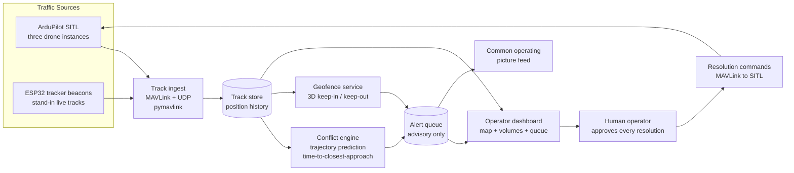
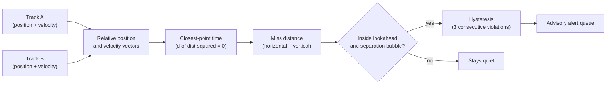

# Mini Airspace Deconfliction Manager

Written by [Taki Sadik](https://tyfsadik.org/about.html) · Last updated 2026-10-22 · Status: Building · 26 min read

A small-scale UAS airspace manager on my bench: ESP32 tracker beacons plus ArduPilot SITL simulated drones, dynamic geofences, predicted-conflict alerts, and a human-in-the-loop override for every resolution.

## Overview

When a dozen uncrewed aircraft share the same block of sky, somebody, or something, has to keep them apart. The **Canadian Army is studying exactly this problem**: how to manage airspace shared by many uncrewed aircraft at once, a discipline known as airspace deconfliction. With the **Defence Drone Initiative** (launched July 23, 2026) promising fleets of cheap tactical drones, and DRDC trials like Operation NANOOK pushing more uncrewed systems into the same training areas, deconfliction stops being an airline problem and becomes a platoon-level one.

This build explores that problem safely and cheaply. It is **mostly simulation**: several ArduPilot SITL drone instances fly missions on my homelab and stream MAVLink telemetry into a manager I wrote. A handful of physical ESP32 tracker beacons stand in for live tracks, so there is real RF hardware in the loop. On top of that track picture sit the two things a deconfliction system actually does: **predict conflicts before separation is lost**, and **enforce dynamic geofences** the operator can draw, move, and resize live.

The design rule that shapes everything: the manager is **advisory, never autonomous**. It proposes resolutions, climb, hold, reroute, and a human approves every single one. That is deliberate: it mirrors how military airspace control actually works, and it makes the system safe to experiment with at any scale.

## Bill of Materials

| Item       | What I used                                    | Est. US\$ |
|------------|------------------------------------------------|-----------|
| Beacons    | 3 cheap ESP32 boards (tracker beacons)         | 6-12 each |
| Simulation | ArduPilot SITL (free), several drone instances | 0         |
| Compute    | Existing laptop / homelab node                 | 0         |
| Display/UI | Web dashboard on the homelab                   | 0         |

This is deliberately the cheapest build in the program: the point is that deconfliction is a software and doctrine problem, not a hardware procurement. The ESP32s were already in the Phase 3 parts bin; everything else is free software and machines I already own.

## Wiring & Connections

There is very little copper in this build, most of the "wiring" is UDP sockets, but the few physical and logical links all have to be right or the track picture goes stale silently:

| From | To | Cable or interface | Notes |
|----|----|----|----|
| ESP32 beacons (x3) | Bench Wi-Fi access point | 2.4 GHz Wi-Fi (WPA2), UDP to manager :5005 | Position packets at 5 Hz; static DHCP lease per beacon MAC so IDs survive reboots |
| Beacon controller ESP32 | SSD1306 OLED display | 4-wire I2C: GPIO21 (SDA), GPIO22 (SCL), 3.3 V, GND | Display at address 0x3C; shows beacon health and active alert count |
| ESP32 boards | Laptop | USB-C cable | Flashing and serial monitor at 115200 baud; removed in normal operation |
| ArduPilot SITL instances | Manager ingest | Loopback UDP 14550-14552 | MAVLink telemetry; GLOBAL_POSITION_INT requested at 10 Hz per instance |
| Manager | SITL instances | Loopback UDP (same MAVLink sockets) | Approved resolution commands only, nothing flows without a human click |
| Manager | MQTT broker (homelab) | TCP 1883 | `cop/air/*` topics, QoS 1; integration feed for the common operating picture |
| Operator browser | Dashboard backend | HTTP :8080 + WebSocket on the LAN | Leaflet map UI; 2 Hz state push, no full-history resend |

## Architecture

Figure 1: simulated and physical tracks flow into one track store; the conflict engine and geofence service raise alerts; a human approves every resolution before any command goes back to an aircraft.

## How Conflict Prediction Works

The conflict engine answers one question for every pair of live tracks: **when will these two aircraft be closest to each other, and how close will that be?** The pipeline runs in four stages, all of them on the constant-velocity model from step 05:

**Figure 2:** the four-stage prediction pipeline: relative motion, time of closest approach, miss distance in horizontal and vertical components, then a stability gate before anything reaches the operator.

Two details make this work in practice rather than just in geometry. First, the vertical check is independent: two tracks can miss by metres horizontally and still be a non-event if they are 80 m apart vertically, so the separation bubble is a cylinder (horizontal radius plus vertical band), not a sphere. Second, the alert must fire with **margin**: the design target is an advisory in the queue at least 30 seconds before the predicted separation loss, giving the human time to read it, decide, and click.

**Why constant velocity is honest here:** predicting 30-60 s ahead with a straight-line model is a deliberate approximation. Real aircraft manoeuvre, which is why the engine recomputes on every 10 Hz telemetry tick and the bubble gets a hysteresis margin: a prediction that updates faster than reality changes beats a perfect model that runs too slowly to keep up.

## How I Built It

### Step 01: Simulated traffic

The first requirement is a busy sky. I run three ArduPilot SITL instances on a homelab node, each with its own instance offset (`-I`, which shifts the base ports by 10 per instance) and its own MAVLink system ID (`--sysid`), and each streaming telemetry out to a dedicated UDP port where the manager listens. Every instance flies an autonomous waypoint mission loaded through MAVProxy, so the virtual field has real crossing traffic, not three drones hovering politely apart.

**Bash, launching three sitl instances**

    # terminal 1 - drone 1 (default ports, telemetry out on 14550)
    sim_vehicle.py -v ArduCopter -I0 --sysid 1 --out=udp:127.0.0.1:14550

    # terminal 2 - drone 2 (base ports shifted by 10, telemetry on 14551)
    sim_vehicle.py -v ArduCopter -I1 --sysid 2 --out=udp:127.0.0.1:14551

    # terminal 3 - drone 3 (telemetry on 14552)
    sim_vehicle.py -v ArduCopter -I2 --sysid 3 --out=udp:127.0.0.1:14552

    # load a mission on drone 1 from its MAVProxy console:
    #   wp load ../missions/cross_a.txt
    #   mode auto

**What can go wrong:** forgetting the `-I` offset makes the second instance collide with the first on ports 5760/5763, and the failure mode is a silently empty telemetry stream rather than an error. I verified each instance by watching for its heartbeat and distinct sysid on its own output port before moving on.

### Step 02: MAVLink ingest and the common track model

The manager opens one pymavlink connection per SITL instance, waits for the heartbeat, then explicitly requests a 10 Hz `GLOBAL_POSITION_INT` stream, the default stream rates are far too low for conflict prediction. Every message is normalised into one track model (`id, lat, lon, alt, vx, vy, vz, ts, source`) so the rest of the system never cares whether a track came from a simulator or a beacon.

**Python, track ingest (ingest.py, trimmed)**

    from pymavlink import mavutil

    SOURCES = {
        1: "udp:127.0.0.1:14550",
        2: "udp:127.0.0.1:14551",
        3: "udp:127.0.0.1:14552",
    }

    conns = {sid: mavutil.mavlink_connection(url) for sid, url in SOURCES.items()}
    for sid, c in conns.items():
        c.wait_heartbeat()
        # ask the autopilot for GLOBAL_POSITION_INT at 10 Hz (interval in microseconds)
        c.mav.command_long_send(
            c.target_system, c.target_component,
            mavutil.mavlink.MAV_CMD_SET_MESSAGE_INTERVAL, 0,
            mavutil.mavlink.MAVLINK_MSG_ID_GLOBAL_POSITION_INT,
            100000, 0, 0, 0, 0, 0)

    msg = conns[1].recv_match(type="GLOBAL_POSITION_INT", blocking=True, timeout=2)
    track = {
        "id": msg.get_srcSystem(), "lat": msg.lat / 1e7, "lon": msg.lon / 1e7,
        "alt": msg.relative_alt / 1000.0,
        "vx": msg.vx / 100.0, "vy": msg.vy / 100.0,
        # GLOBAL_POSITION_INT vz is cm/s positive DOWN; the track model is up-positive
        "vz": -msg.vz / 100.0,
        "source": "sitl",
    }

**How I verified:** I printed the inter-arrival time of `GLOBAL_POSITION_INT` per instance; before the `SET_MESSAGE_INTERVAL` request it sat near 1 Hz and the predicted tracks jumped, after it the stream settled at 10 Hz and predictions smoothed out.

### Step 03: Physical tracker beacons

Three cheap ESP32 boards act as tracker beacons, stand-ins for live aircraft. Each runs a small Arduino sketch (Arduino-ESP32 core) that joins the bench Wi-Fi and broadcasts a JSON position packet over UDP to the manager at 5 Hz, in exactly the track model from step 02 so the ingest path cannot tell simulated from physical. The beacons matter less for their data than for their reality: they force the pipeline to survive dropped packets, jitter, and reboots, nuisances SITL never has.

**Arduino, beacon firmware (beacon.ino, trimmed)**

    #include <WiFi.h>
    #include <WiFiUdp.h>

    const char* SSID = "benchlab";
    const char* PASS = "....";
    const char* MANAGER_IP = "192.168.1.50";
    const uint16_t MANAGER_PORT = 5005;
    const int BEACON_ID = 101;      // unique per board

    WiFiUDP udp;

    void setup() {
      WiFi.mode(WIFI_STA);
      WiFi.setSleep(false);          // modem sleep eats UDP packets in bursts
      WiFi.begin(SSID, PASS);
      while (WiFi.status() != WL_CONNECTED) delay(250);
    }

    void loop() {
      // stand-in track: a slow circle, like a drone loitering on station
      float t = millis() / 1000.0f;
      float lat = 43.7615f + 0.0005f * cosf(t / 20.0f);
      float lon = -79.4111f + 0.0005f * sinf(t / 20.0f);
      char pkt[160];
      snprintf(pkt, sizeof(pkt),
        "{\"src\":\"beacon\",\"id\":%d,\"lat\":%.6f,\"lon\":%.6f,\"alt\":%.1f,\"vx\":%.2f,\"vy\":%.2f}",
        BEACON_ID, lat, lon, 120.0f, 0.0f, 0.0f);
      udp.beginPacket(MANAGER_IP, MANAGER_PORT);
      udp.write((const uint8_t*)pkt, strlen(pkt));
      udp.endPacket();
      delay(200);                    // 5 Hz
    }

**What can go wrong:** ESP32 modem sleep (`WIFI_PS_MIN_MODEM` is the default) buffers and bursts UDP packets, which looks exactly like a manoeuvring aircraft to the conflict engine. `WiFi.setSleep(false)` fixed it; I confirmed with a packet-gap histogram on the manager side.

### Step 04: Beacon ingest and health monitoring

The manager runs a small UDP listener for the beacons. The important design decision: **timestamp at ingest, never trust the device clock**, the ESP32s have no real-time clock, so their idea of "now" is useless for a system whose entire job is time-based prediction. The listener also watches per-beacon health and marks a track STALE when packets stop, so a dead beacon drops out of conflict computations instead of freezing in place as a ghost hazard.

**Python, beacon udp listener**

    import json, socket, time

    sock = socket.socket(socket.AF_INET, socket.SOCK_DGRAM)
    sock.bind(("0.0.0.0", 5005))
    sock.settimeout(1.0)

    last_seen = {}
    STALE_AFTER_S = 2.0

    while True:
        try:
            data, addr = sock.recvfrom(2048)
        except socket.timeout:
            data = None
        if data:
            msg = json.loads(data)
            msg["ts"] = time.time()          # stamp here - beacon has no RTC
            tracks.update(msg)
            last_seen[msg["id"]] = msg["ts"]
        now = time.time()
        for bid, ts in last_seen.items():
            tracks.mark_stale(bid, now - ts > STALE_AFTER_S)

**How I verified:** I pulled the USB power on one beacon mid-run and watched the dashboard: the track must flip to STALE within the timeout and disappear from the conflict engine's pair list. Before the stale logic, a powered-off beacon lingered forever as a phantom conflict.

### Step 05: Conflict engine

The core of the system. For every live track I propagate a constant-velocity prediction forward and compute the **time to closest point of approach (TCPA)** between every pair, in horizontal and vertical components separately, two aircraft 10 m apart horizontally but 80 m apart vertically are not a conflict. If TCPA falls inside the lookahead window and both miss distances fall inside the separation bubble, the engine raises an alert before separation is actually lost. The pairwise check is O(n²), trivial at this scale; the real work is in the tunables (bubble radius, vertical separation, lookahead) and in alert stability.

**Python, tcpa between two tracks**

    import math

    def tcpa(a, b):
        """Time and miss distance of closest approach, two constant-velocity tracks.
        Closest approach is taken on the horizontal plane; vertical separation is
        read at that time, so a flyby that is far apart vertically never reads
        as a conflict."""
        rx, ry, rz = b.x - a.x, b.y - a.y, b.alt - a.alt
        vx, vy, vz = b.vx - a.vx, b.vy - a.vy, b.vz - a.vz
        vv = vx*vx + vy*vy + vz*vz
        if vv < 1e-6:
            # parallel tracks: closest approach is right now
            return 0.0, math.hypot(rx, ry), abs(rz)
        hv = vx*vx + vy*vy
        if hv < 1e-6:
            t = 0.0   # no horizontal motion: horizontal miss is current separation
        else:
            t = max(0.0, -(rx*vx + ry*vy) / hv)
        horiz = math.hypot(rx + vx*t, ry + vy*t)   # horizontal miss (m)
        vert = abs(rz + vz*t)                       # vertical miss at that time (m)
        return t, horiz, vert

    def check_pair(a, b, lookahead_s=60, h_sep=100, v_sep=30):
        t, horiz, vert = tcpa(a, b)
        return t <= lookahead_s and horiz < h_sep and vert < v_sep

**What can go wrong:** with a single-sample threshold, alerts flap on and off as telemetry jitters near the bubble boundary. I require three consecutive violating predictions to raise an alert and a clear margin to release it (hysteresis), verified by walking a simulated track tangentially along the bubble edge and watching the queue stay quiet.

### Step 06: Dynamic geofences

The geofence service holds 3D keep-in and keep-out volumes, cylinders and boxes with floor and ceiling altitudes, defined as plain JSON so the dashboard can create, move, and resize them live. Every incoming track update is tested against all active volumes and a violation alerts immediately. This mirrors the real use case: an exercise safety officer declaring a temporary restricted volume over a live-fire range, or shrinking the keep-in box as weather moves in.

**Json, a keep-out volume**

    {
      "id": "RZ-ALPHA",
      "type": "keep-out",
      "shape": "cylinder",
      "center": {"lat": 43.7615, "lon": -79.4111},
      "radius_m": 250,
      "floor_m": 0,
      "ceil_m": 150
    }

**Python, point-in-volume check**

    def inside_cylinder(track, vol):
        d = haversine_m(track.lat, track.lon,
                        vol["center"]["lat"], vol["center"]["lon"])
        in_footprint = d <= vol["radius_m"]
        in_altband = vol["floor_m"] <= track.alt <= vol["ceil_m"]
        return in_footprint and in_altband

**What can go wrong:** naive degree arithmetic (treating lat/lon as flat) distorts distances badly at Toronto's latitude, a 250 m radius becomes an ellipse. I convert through haversine / a local ENU frame everywhere, and verified by checking that a circle drawn on the dashboard measures the same radius north-south as east-west.

### Step 07: Operator dashboard

The UI is a small FastAPI backend on the homelab pushing state over a WebSocket to a Leaflet page: tracks as moving markers, geofence volumes as shaded 2D footprints with floor and ceiling labels (Leaflet renders in 2D, so true 3D extrusion would need a separate rendering layer), and the alert queue down the side with approve/reject buttons. It runs at a 2 Hz push of *current state only*, the browser is a display, not a database.

**Python, dashboard backend (trimmed)**

    import asyncio
    from fastapi import FastAPI, WebSocket

    app = FastAPI()

    @app.websocket("/ws")
    async def feed(ws: WebSocket):
        await ws.accept()
        while True:
            await ws.send_json({
                "tracks": tracks.snapshot(),      # current state only
                "volumes": geofences.snapshot(),
                "alerts": alert_queue.pending(),  # advisory queue, needs a human
            })
            await asyncio.sleep(0.5)              # 2 Hz UI refresh

**What can go wrong:** my first version shipped full track history every tick and the browser tab crawled after a few minutes. Sending only the latest state (and letting the front end keep short trails) fixed it, verified with the browser's performance panel over a long soak.

### Step 08: Human-in-the-loop resolutions

When the conflict engine fires, the manager proposes manoeuvres, an altitude change for one track, a hold, or a reroute around the predicted conflict point, but the queue is **advisory, never autonomous**: nothing reaches an aircraft until a human clicks approve. Approved resolutions go back to the SITL instance as MAVLink commands, and the dashboard then tracks whether the approved manoeuvre actually cleared the conflict; rejected proposals are logged with their outcomes for the test-case review.

**Python, sending an approved altitude resolution to sitl**

    def send_guided_alt(conn, lat_deg, lon_deg, alt_m):
        # switch the vehicle to GUIDED with an explicit mode command, then verify;
        # MAV_CMD_NAV_GUIDED_ENABLE is for Guided-within-Auto, not a plain mode switch
        guided = conn.mode_mapping()["GUIDED"]
        conn.mav.command_long_send(
            conn.target_system, conn.target_component,
            mavutil.mavlink.MAV_CMD_DO_SET_MODE, 0,
            mavutil.mavlink.MAV_MODE_FLAG_CUSTOM_MODE_ENABLED,
            guided, 0, 0, 0, 0, 0)
        conn.mav.set_position_target_global_int_send(
            0, conn.target_system, conn.target_component,
            mavutil.mavlink.MAV_FRAME_GLOBAL_RELATIVE_ALT_INT,
            0b110111111000,      # type_mask: use lat/lon/alt, ignore vel/accel/yaw
            int(lat_deg * 1e7), int(lon_deg * 1e7), alt_m,
            0, 0, 0,             # velocity ignored
            0, 0, 0,             # acceleration ignored
            0, 0)                # yaw, yaw_rate ignored

**How I verified:** I watch for the `COMMAND_ACK` and then re-run the TCPA computation on the post-command track, an approved climb is only counted as a resolution when the predicted closest approach moves outside the bubble. Commands sent before the mode switch are silently ignored, which was my first "why didn't it climb?" bug, and I confirm the heartbeat's `custom_mode` reports GUIDED before the position target goes out.

### Step 09: Scripted test cases

Deconfliction logic is only worth trusting if it survives repeatable scenarios, so I scripted a set of conflict cases, crossing paths at a common altitude, converging altitudes on parallel tracks, and a deliberate geofence breach, each defined as mission files plus any volumes, runnable repeatedly with identical initial conditions. Every run produces a result sheet (the paper copies on the bench on the bench) that gets signed off with what the system detected, when it alerted, and how the resolution played out.

**Python, scenario harness (trimmed)**

    SCENARIOS = {
        "crossing-paths":    {"missions": {1: "missions/cross_a.txt",
                                           2: "missions/cross_b.txt"}},
        "altitude-converge": {"missions": {1: "missions/level_a.txt",
                                           2: "missions/climb_b.txt"}},
        "geofence-breach":   {"missions": {1: "missions/straight_a.txt"},
                              "volumes": ["volumes/rz_alpha.json"]},
    }

    def run(name, repeat=10):
        for i in range(repeat):
            reset_sitl()                        # wipe state between runs
            load_scenario(SCENARIOS[name])      # wp load per drone, push volumes
            t0 = time.time()
            result = watch_until_resolved(timeout=300)
            sheet.log(name, i,
                      time_to_alert_s=result.alert_t - t0,
                      margin_s=result.loss_t - result.alert_t,
                      cleared=result.cleared)

**What can go wrong:** SITL leaks state between runs (leftover waypoints, changed parameters), which makes "repeatable" runs anything but. The harness restarts instances and wipes (`sim_vehicle.py -w`) before every run; I confirmed repeatability by diffing the mission state at `t0` across runs.

### Step 10: Integration with the common operating picture

The manager does not live alone: its tracks and alerts publish into the [multi-domain common operating picture](https://github.com/TYFSADIK/multi-domain-common-operating-picture) over the same MQTT bus the other defence nodes use, signed the same way, so air tracks become one more layer alongside the passive radar, acoustic, and ground sensors, and the COP's human-in-the-loop queue is the same one this manager writes to.

**Python, publishing alerts to the cop bus**

    import json
    import paho.mqtt.client as mqtt

    bus = mqtt.Client(client_id="airspace-manager")
    # paho queues outbound publishes in memory while disconnected; this is NOT a
    # disk-backed store-and-forward queue and does not survive a process restart
    bus.max_queued_messages_set(100)
    bus.reconnect_delay_set(min_delay=1, max_delay=30)
    bus.connect("mqtt.homelab.local", 1883)

    def on_alert(alert):
        payload = json.dumps(alert, separators=(",", ":"))
        bus.publish(
            "cop/air/alerts",
            json.dumps({"msg": payload, "sig": sign_ed25519(payload)}),
            qos=1)          # at-least-once; survives Wi-Fi blips while connected

**What can go wrong:** at QoS 0 an alert can vanish on a Wi-Fi hiccup, the worst kind of failure for an advisory system, because the operator never knows it existed. QoS 1 plus paho's in-memory queued messages while the broker is unreachable covers brief outages, with a caveat: that queue is in memory only, so a broker outage that outlasts the process loses alerts. A disk-backed outbox like the COP build's is the hardened path; I verify by killing the broker mid-scenario and confirming the alert arrives on restart.

## Testing & Metrics

Testing is scenario-driven, built around the scripted harness from step 09. Every numbered run below follows the same discipline: identical initial conditions, a fresh SITL state, a signed result sheet per repetition, and a pass only when the alert precedes the separation loss with margin.

### Run 1, Crossing paths

**Setup:** two SITL drones on perpendicular waypoint courses at the same altitude, timed to reach the intersection within seconds of each other. **Procedure:** start both missions simultaneously, let the conflict engine run, then approve the proposed altitude resolution for one drone. **Metric:** time-to-alert (scenario start to alert in queue) and alert margin (alert time to predicted separation loss); post-resolution, the recomputed TCPA must sit outside the bubble.

### Run 2, Altitude convergence

**Setup:** two drones on parallel tracks, one climbing through the other's altitude at a fixed vertical rate. **Procedure:** no operator input until the alert fires; then approve a hold for the climbing drone. **Metric:** whether the vertical miss distance is computed correctly (this run exists because horizontal-only checks pass here while separation is actually being lost), and time-to-alert margin as in Run 1.

### Run 3, Geofence breach and live edit

**Setup:** one drone on a straight course through where a keep-out cylinder will appear. **Procedure:** create the volume live from the dashboard while the drone is inbound, then move and resize it mid-run. **Metric:** violation alert latency from the crossing telemetry packet, and enforcement latency from each live edit, target is the next track update.

### Run 4, Quiet-sky false-alarm soak

**Setup:** three SITL drones on well-separated missions plus all three beacons running their stand-in tracks, no designed conflict. **Procedure:** soak for two hours with normal waypoint traffic and beacon jitter. **Metric:** false-alarm count, target is zero; every spurious alert gets root-caused before the soak counts.

### Run 5, Degraded track (beacon drop-out mid-conflict)

**Setup:** a beacon on a converging course with a SITL drone. **Procedure:** kill the beacon's power after the conflict engine has begun tracking the pair, then restore it. **Metric:** the track must flag STALE inside the timeout, the conflict must downgrade gracefully rather than freeze on the last position, and the track must rejoin cleanly on beacon return.

### Targets and Current Status

| Metric | Target | Current status |
|----|----|----|
| Time-to-alert margin (Runs 1-2) | Alert at least 30 s before predicted separation loss | In progress, harness runs, sheets being filled |
| False alerts (Run 4) | Zero over a 2-hour quiet soak | In progress |
| Resolution clearance | Predicted CPA outside the bubble after every approved manoeuvre | In progress |
| Geofence edit-to-enforcement (Run 3) | Next track update (1 s or less) | In progress |
| Stale-track detection (Run 5) | Flag within 2 s of the last beacon packet | In progress |

No results are published yet: the scenario harness runs and the result sheets are being filled in, but numbers go up only when every scripted case has been run repeatedly and the sheets are consistent.

## Troubleshooting & Lessons

- **Second SITL instance never connected:** I forgot the `-I` instance offset, so both instances fought over the same ports and the second one's telemetry silently went nowhere. Fix: unique `-I` and `--sysid` per instance, and a heartbeat check in the ingest path that screams instead of waiting forever.
- **Beacons dropped packets in bursts:** the ESP32's default modem sleep batches radio traffic, which made stand-in tracks jump and nearly triggered false conflicts. Fix: `WiFi.setSleep(false)` in the beacon firmware, confirmed with a packet-gap histogram.
- **Alerts flapped at the bubble boundary:** a single-sample threshold raised and cleared the same conflict several times a second as telemetry jittered. Fix: require three consecutive violating predictions to raise, and a clear margin to release, classic hysteresis.
- **Predictions were useless at default telemetry rates:** SITL streams position slowly unless asked, and 1 Hz updates made TCPA estimates jump around. Fix: request `GLOBAL_POSITION_INT` at 10 Hz with `MAV_CMD_SET_MESSAGE_INTERVAL` on connect.
- **"Repeatable" scenarios were not repeatable:** SITL kept leftover waypoints and parameters between runs, so run 2 never matched run 1. Fix: the harness restarts instances and wipes state (`sim_vehicle.py -w`) before every run.

## Legal & Safety Notes

**Simulation-first by design:** this build is deliberately mostly software. ArduPilot SITL carries all flying while the legal side stays simple, real flying waits for Transport Canada compliance (registration, pilot certification, and airspace checks), the same rule that gates the thermal SAR drone build.

**Scope:** this project coordinates only my own aircraft and simulated traffic. The ESP32 beacons broadcast stand-in positions on my own network; nothing here tracks, commands, or interferes with anyone else's aircraft.

## Status & Roadmap

- **Done**: multi-instance ArduPilot SITL environment with MAVLink ingest via pymavlink; common track model covering simulated and beacon tracks; ESP32 beacon firmware broadcasting stand-in positions; dynamic 3D geofence service with live edit and violation alerts; operator dashboard with alert queue and approve/reject flow.
- **In progress**: conflict-engine tuning (separation bubble, lookahead horizon, alert flapping); scripted test-case harness with signed result sheets; resolution manoeuvre set (altitude change, hold, reroute) end-to-end back into SITL.
- **Next**: publish scenario metrics once runs are repeatable; publish tracks and alerts into the common operating picture; add a third scripted scenario family (beacon drop-out mid-conflict) to test degraded-track behaviour.

## Related Builds

- [**Canadian Defence Hardware Program**](https://github.com/TYFSADIK/defence-hardware-program), the program hub; this manager is one of the sky builds.
- [**Multi-Domain Common Operating Picture**](https://github.com/TYFSADIK/multi-domain-common-operating-picture), where this manager's tracks and alerts ultimately flow.
- [**Thermal Search-and-Rescue Drone**](https://github.com/TYFSADIK/thermal-sar-drone), the real aircraft this manager would one day share airspace with; also SITL-first pending Transport Canada compliance.
- [**Operation LENTUS-Style Drone Mapping**](https://github.com/TYFSADIK/lentus-drone-mapping), the simulation-side drone workflow that reuses the same ArduPilot SITL environment.

## Build Narrative: Phase by Phase

**Phase 1: simulation environment.** Several ArduPilot SITL drone instances fly missions on the homelab and stream MAVLink telemetry. Each instance gets a unique -I offset and sysid, after an early session where two instances fought over the same ports and the second one's telemetry silently went nowhere; the ingest path now runs a heartbeat check that screams instead of waiting forever.

**Phase 2: telemetry ingest.** pymavlink ingests the SITL streams into the manager. Default SITL telemetry rates made TCPA estimates jump, so the manager requests GLOBAL_POSITION_INT at 10 Hz with MAV_CMD_SET_MESSAGE_INTERVAL on connect.

**Phase 3: physical stand-ins.** Three cheap ESP32 tracker beacons broadcast stand-in positions so there is real RF hardware in the loop. The ESP32's default modem sleep batched radio traffic and made tracks jump toward false conflicts; WiFi.setSleep(false) in the firmware fixed it, confirmed with a packet-gap histogram.

**Phase 4: conflict engine.** Predicted conflicts come from time-to-closest-point-of-approach against a separation bubble and a lookahead horizon. A single-sample threshold flapped alerts several times a second on telemetry jitter, so raising now requires three consecutive violating predictions and release needs a clear margin, classic hysteresis.

**Phase 5: geofences and resolutions.** A dynamic 3D geofence service supports operator-drawn, moved, and resized volumes with live violation alerts. Resolution manoeuvres (climb, hold, reroute) run end to end back into SITL. The manager is advisory only: it proposes, a human approves every resolution, mirroring how military airspace control actually works.

**Phase 6: test harness.** A scripted test-case harness restarts instances and wipes state (`sim_vehicle.py -w`) before every run, because leftover waypoints and parameters made run 2 never match run 1. Result sheets are signed so repeats are comparable.

## What You Need

The cheapest build in the program on purpose: deconfliction is a software and doctrine problem, not a hardware procurement. The only real cost is compute you already own.

| Category | Item | Notes |
|----|----|----|
| Hardware | 3 ESP32 tracker beacons | Cheap boards as live RF stand-ins; disable modem sleep in the firmware |
| Hardware | Compute | Existing laptop or homelab node for the SITL instances and the manager |
| Software | ArduPilot SITL | Free; several drone instances with unique -I offsets and sysids |
| Software | pymavlink, Python | MAVLink ingest at 10 Hz, the common track model, the conflict engine |
| Software | Web dashboard | Operator view with the alert queue and the approve/reject flow |
| Skills | Python, MAVLink basics, software testing | Scenario design, hysteresis tuning, disciplined repeatable test harnesses |
| Accounts | None | No accounts or licenses required |

## Challenges and Lessons Learned

- **The second SITL instance never connected.** I forgot the -I instance offset, so both instances fought over the same ports. Lesson: unique -I and sysid per instance, and a heartbeat check in the ingest path that screams instead of waiting forever.
- **Beacons dropped packets in bursts.** ESP32 modem sleep batched radio traffic and stand-in tracks jumped, nearly triggering false conflicts. Lesson: WiFi.setSleep(false) in beacon firmware, confirmed with a packet-gap histogram.
- **Alerts flapped at the bubble boundary.** A single-sample threshold raised and cleared the same conflict several times a second. Lesson: three consecutive violations to raise, a clear margin to release, classic hysteresis.
- **Predictions were useless at default telemetry rates.** 1 Hz position updates made TCPA estimates jump. Lesson: request 10 Hz GLOBAL_POSITION_INT on connect with MAV_CMD_SET_MESSAGE_INTERVAL.
- **Repeatable scenarios were not repeatable.** SITL kept leftover waypoints and parameters between runs. Lesson: the harness restarts instances and wipes state before every run.

## What Is Next

- Publish scenario metrics once runs are fully repeatable: detection lead time, false-alert rate, resolution success.
- Publish tracks and alerts into the multi-domain common operating picture.
- Add a third scripted scenario family: beacon drop-out mid-conflict, testing how the engine behaves when a track degrades during an active alert.
- Tune the lookahead horizon against the scenario data rather than by feel.
- Longer term, feed real outdoor flight tracks (from the thermal SAR drone) into the manager as live data alongside the beacons.

## Frequently Asked Questions

I forgot the -I instance offset, so both instances fought over the same ports and the second one's telemetry silently went nowhere. Fix: unique -I and --sysid per instance, and a heartbeat check in the ingest path that screams instead of waiting forever.

the ESP32's default modem sleep batches radio traffic, which made stand-in tracks jump and nearly triggered false conflicts. Fix: WiFi.setSleep(false) in the beacon firmware, confirmed with a packet-gap histogram.

a single-sample threshold raised and cleared the same conflict several times a second as telemetry jittered. Fix: require three consecutive violating predictions to raise, and a clear margin to release, classic hysteresis.

SITL streams position slowly unless asked, and 1 Hz updates made TCPA estimates jump around. Fix: request GLOBAL_POSITION_INT at 10 Hz with MAV_CMD_SET_MESSAGE_INTERVAL on connect.

SITL kept leftover waypoints and parameters between runs, so run 2 never matched run 1. Fix: the harness restarts instances and wipes state (sim_vehicle.py -w) before every run.

## Cite This Page

**Plain text**

    Taki Sadik, "Mini Airspace Deconfliction Manager", TYFSADIK, https://github.com/TYFSADIK/airspace-deconfliction-manager (accessed 2026-10-22).

**BibTeX**

    @misc{sadik-airspace-deconfliction-manager,
      author  = {Sadik, MD. Taki Yasir Faraji},
      title   = {Mini Airspace Deconfliction Manager},
      year    = {2026},
      url     = {https://github.com/TYFSADIK/airspace-deconfliction-manager},
      urldate = {2026-10-22}
    }

**APA**

    Sadik, M. T. Y. F. (2026). Mini Airspace Deconfliction Manager. TYFSADIK. https://github.com/TYFSADIK/airspace-deconfliction-manager

---

Original page: <https://github.com/TYFSADIK/airspace-deconfliction-manager>
